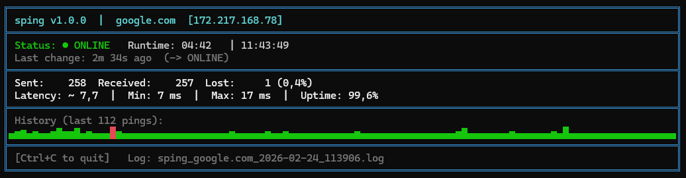

# sping

A robust PowerShell-based ping monitoring tool with live dashboard, sound alerts and automatic logging.



## Features

- **Live dashboard** – updates in-place, no terminal spam
- **Sound alerts on status change** – distinct tones for online/offline transitions
- **Automatic logging** – every session gets its own timestamped log file
- **Statistics** – average latency, min, max, uptime percentage, loss rate
- **Sparkline** – visual history bar of recent pings
- **DNS resolution** – displays hostname and resolved IP
- **Clean exit** – summary on Ctrl+C or after `-n` pings complete
- **No dependencies** – requires only PowerShell 5.1+, no installation needed

## Installation

### Requirements

- Windows with PowerShell 5.1 or newer

### Steps

#### 1. Place the files

The script and batch wrapper are already in the `sping\` folder. Nothing to install.

#### 2. Make sping globally available (one-time setup)

Add the `sping` folder to your PATH – run once in PowerShell, no admin required:

```powershell
$spingPath = "C:\...\Skripte\sping"
$currentPath = [Environment]::GetEnvironmentVariable("Path", "User")
[Environment]::SetEnvironmentVariable("Path", "$currentPath;$spingPath", "User")
```

#### 3. Open a new terminal

From any new terminal window, `sping` will work from any directory.

> To activate the new PATH immediately in an already-open terminal:
>
> ```powershell
> $env:Path = [Environment]::GetEnvironmentVariable("Path","User") + ";" + [Environment]::GetEnvironmentVariable("Path","Machine")
> ```

## Usage

```cmd
sping <target> [<target> ...] [-l <list>] [-n <count>] [-i <interval>] [-w <timeout>] [-NoSound] [-NoLog]
```

Follows Windows `ping` syntax where possible:

| `ping` (reference)            | `sping`                          |
| ----------------------------- | -------------------------------- |
| `ping <host>` (4 pings)       | `sping <host>` **(continuous!)** |
| `ping -t <host>` (continuous) | `sping <host>` (= default)       |
| `ping -n 10 <host>`           | `sping <host> -n 10`             |
| `ping -w 2000 <host>`         | `sping <host> -w 2000`           |

### Parameters

| Parameter  | Default         | Description                              |
| ---------- | --------------- | ---------------------------------------- |
| `<target>` | –               | One or more hostnames or IP addresses    |
| `-l <name>` | –              | Load a named target list from `sping.ini`|
| `-n <int>` | `0` (unlimited) | Pings per target, then print summary     |
| `-i <int>` | `1000`          | Interval between pings in ms             |
| `-w <int>` | `3000`          | Timeout per ping in ms                   |
| `-NoSound` | –               | Disable sound alerts                     |
| `-NoLog`   | –               | Disable logging                          |

### Examples

```powershell
sping google.com                 # Continuous ping with dashboard, sound and log
sping 192.168.1.1 8.8.8.8        # Monitor multiple targets in parallel
sping server01,server02 -n 10    # Comma-separated targets, 10 pings each
sping -l itcs                    # Use the itcs list from sping.ini
sping 192.168.1.1 -i 500        # Faster interval (500 ms)
sping server01 -n 20             # 20 pings, then print summary and exit
sping 8.8.8.8 -NoSound          # Silent monitoring
sping 10.0.0.1 -NoLog -n 5      # Quick check without log file
```

## Logging

Logging is **enabled by default**. A log file is automatically created in the current working directory:

```
sping_<host>_<date>_<time>.log
```

Example: `sping_google.com_2026-02-24_1430.log`

For multiple targets, the session is written to `sping_multiple_targets_<date>_<time>.log`; each ping and status change includes its target.

**Log format:**

```cmd
# sping v1.0.0  |  Session started: 2026-02-24 14:30:00  |  Targets: google.com [142.250.185.99]
# Interval: 1000ms  |  Timeout: 3000ms  |  Count: unlimited
[2026-02-24 14:30:00.123] OK        12 ms
[2026-02-24 14:30:01.145] OK        11 ms
[2026-02-24 14:30:02.201] FAIL    timeout
[2026-02-24 14:30:02.201] ### STATUS CHANGE: ONLINE -> OFFLINE ###
...
# Session ended: 2026-02-24 14:45:00  |  Sent: 900  Received: 898  Lost: 2
```

## Target Lists

Create `sping.ini` in the same directory as `sping.ps1`. Add each list as a key under `[lists]`; separate hostnames or IP addresses with commas:

```ini
[lists]
itcs = switch01, 10.20.0.1, 10.20.0.2
printers = printer01, 10.30.0.15
```

Run a list with `sping -l itcs`. List names are case-insensitive. Direct targets and `-l` cannot be used in the same command. `[targets]` and the previous format with one section per list are also supported.

Disable logging: `-NoLog`

## Sounds

| Event             | Tone                                     |
| ----------------- | ---------------------------------------- |
| Offline → Online  | Two short high tones (1000 Hz + 1400 Hz) |
| Online → Offline  | Two long low tones (500 Hz + 320 Hz)     |

Disable sounds: `-NoSound`

## Technical Details

- Uses `.NET System.Net.NetworkInformation.Ping` for accurate RTT measurement
- `StreamWriter` with `AutoFlush` for reliable logging without file access conflicts
- Dashboard redraws via cursor repositioning – no flicker, no spam
- Clean `finally` block closes log and ping object on any exit
- Compatible with Windows PowerShell 5.1+

## Files

| File          | Description                         |
| ------------- | ----------------------------------- |
| `sping.ps1`   | Main script                         |
| `sping.cmd`   | Batch wrapper for global invocation |
| `README.md`   | This documentation                  |
| `LICENSE.md`  | MIT License                         |

## License

This project is licensed under the [MIT License](LICENSE.md).
